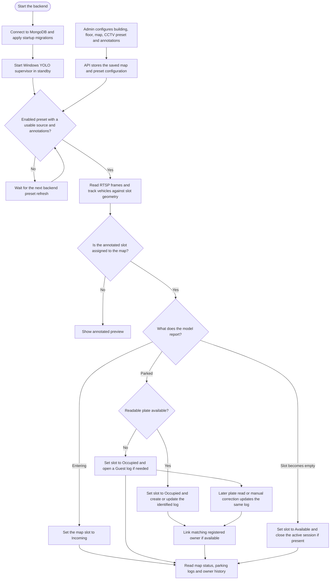
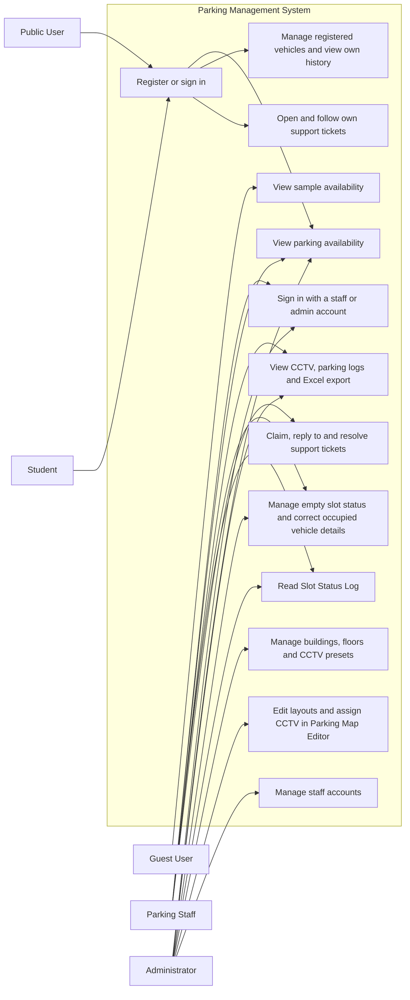
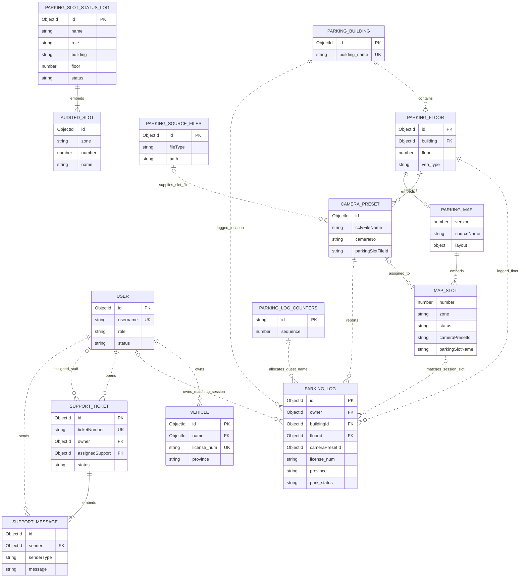
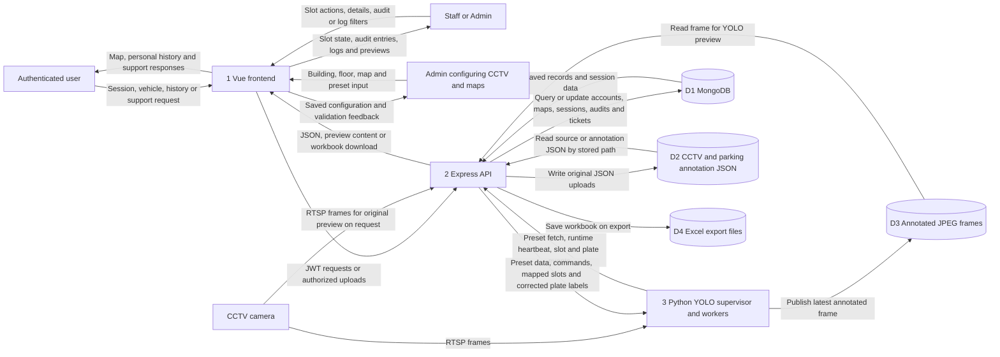

# Proposal Material for the Parking Management System

Use these tables and figures in Chapter 3, **System Analysis and Methodology**, of the [senior project proposal](../../docs/Proposal/Parking_Management_System_Proposal.md). The system flowchart explains the overall workflow. The user diagram shows role interactions. The ER diagram explains stored relationships. The data flow diagram shows what information passes between systems.

## 1 Data Dictionary

The dictionary documents the current Mongoose collections and the embedded structures used by the system. **PK** marks the document key in a top-level collection. MongoDB stores dates as `Date` where indicated and stores Bangkok-local display dates and times as strings elsewhere. Examples and IDs are synthetic. Embedded JSON examples may show only part of a record.

### 1.1 `user`

| Column | Data Type | Description | Example |
| --- | --- | --- | --- |
| `_id` (PK) | ObjectId | Generated MongoDB document key. | `000000000000000000000101` |
| `username` | String | Required unique login name. | `student_demo` |
| `password` | String | Required bcrypt hash excluded from normal queries. | `[hash omitted]` |
| `name` | String | Required display name. | `Demo Driver` |
| `role` | String | Required account role. Values are `user`, `public`, `staff`, and `admin`. | `user` |
| `status` | String | `online`, `offline`, or `disable`. Defaults to `offline`. | `online` |
| `date_updated` | String | Required last update date in Bangkok time, formatted YYYY-MM-DD. | `2026-11-16` |
| `time_updated` | String | Required last update time in Bangkok time, formatted HH:mm:ss. | `08:35:00` |
| `user_image` | String | Profile image path. Defaults to `null`. | `images/user/demo.png` |

**Table 3.1:** `user`

### 1.2 `vehicle`

| Column | Data Type | Description | Example |
| --- | --- | --- | --- |
| `_id` (PK) | ObjectId | Generated MongoDB document key. | `000000000000000000000102` |
| `veh_type` | String | Required vehicle type. Values are `car` and `motorcycle`. | `car` |
| `name` | ObjectId | Required reference to the owner's `user._id`. | `000000000000000000000101` |
| `brand` | String | Required make. | `Toyota` |
| `model` | String | Required model. | `Corolla` |
| `color` | String | Required color. | `White` |
| `license_num` | String | Required unique plate number. | `AB 1234` |
| `province` | String | Required registration province. | `Chiang Rai` |

**Table 3.2:** `vehicle`

### 1.3 `parking_building`

| Column | Data Type | Description | Example |
| --- | --- | --- | --- |
| `_id` (PK) | ObjectId | Generated MongoDB document key. | `000000000000000000000201` |
| `building_name` | String | Required unique building name. | `Demo Building` |
| `building_image` | String | Building image path. Defaults to `null`. | `null` |
| `date_updated` | String | Required last update date in Bangkok time, formatted YYYY-MM-DD. | `2026-11-16` |
| `time_updated` | String | Required last update time in Bangkok time, formatted HH:mm:ss. | `08:35:00` |

**Table 3.3:** `parking_building`

### 1.4 `parking_floor`

| Column | Data Type | Description | Example |
| --- | --- | --- | --- |
| `_id` (PK) | ObjectId | Generated MongoDB document key. | `000000000000000000000301` |
| `building` | ObjectId | Required reference to `parking_building._id`. | `000000000000000000000201` |
| `floor` | Number | Required integer floor number. Building, floor, and vehicle type identify a configured location. | `1` |
| `veh_type` | String | Required vehicle type. Values are `car` and `motorcycle`. | `car` |
| `parking_slot_file` | String | Optional legacy single-file path. Defaults to `null`. | `null` |
| `parking_map` | Mixed | Embedded layout and slot data. Defaults to `null`. | `{"version": 2}` |
| `camera_presets` | Array of objects | CCTV presets embedded in the floor. | `[{"name": "Entrance A"}]` |
| `status` | String | `Available` or `Disable`. Defaults to `Disable`. | `Available` |
| `date_updated` | String | Required last update date in Bangkok time, formatted YYYY-MM-DD. | `2026-11-16` |
| `time_updated` | String | Required last update time in Bangkok time, formatted HH:mm:ss. | `08:35:00` |

**Table 3.4:** `parking_floor`

The plural `parking_slot_files` array is retired. Startup migration copies older file metadata and IDs to `parking_source_files` before removing the array.

### 1.5 `parking_source_files`

| Column | Data Type | Description | Example |
| --- | --- | --- | --- |
| `_id` (PK) | ObjectId | Generated MongoDB document key. | `000000000000000000000501` |
| `original_name` | String | Required original filename. | `demo_slots.json` |
| `path` | String | Required stored path to the uploaded file. | `json_file/parking_slots/demo_slots.json` |
| `size` | Number | Required file size in bytes. | `24576` |
| `fileType` | String | `cctv` or `parking-slot`. Defaults to `cctv`. | `parking-slot` |
| `createdAt` | Date | Creation timestamp. | `2026-11-16T01:30:00.000Z` |
| `updatedAt` | Date | Last modification timestamp. | `2026-11-16T01:35:00.000Z` |
| `__v` | Number | Mongoose version field. | `0` |

**Table 3.5:** `parking_source_files`

### 1.6 `parking_log`

| Column | Data Type | Description | Example |
| --- | --- | --- | --- |
| `_id` (PK) | ObjectId | Generated MongoDB document key. | `000000000000000000000601` |
| `owner` | ObjectId | Reference to `user._id` for a registered match. Defaults to `null` for a Guest. | `000000000000000000000101` |
| `name` | String | Owner display name or Guest label. Defaults to an empty string. | `Demo Driver` |
| `building` | String | Required building name recorded with the event. | `Demo Building` |
| `buildingId` | ObjectId | Required reference to `parking_building._id`. | `000000000000000000000201` |
| `floor` | Number | Required floor number recorded with the event. | `1` |
| `floorId` | ObjectId | Required reference to `parking_floor._id`. | `000000000000000000000301` |
| `veh_type` | String | Required vehicle type. Values are `car` and `motorcycle`. | `car` |
| `cameraPresetId` | ObjectId | Required ID of the preset embedded in the referenced floor. | `000000000000000000000401` |
| `parkingSlotName` | String | Assigned annotation category. Defaults to `null`. | `zoneA_slot07` |
| `trackedSlotSession` | Boolean | Optional flag used by the unique active slot index. | `true` |
| `vehicleDetailsEdited` | Boolean | Optional flag indicating a manual correction. | `true` |
| `brand` | String | Vehicle make from the matched record. Defaults to `Unknown`. | `Toyota` |
| `model` | String | Vehicle model from the matched record. Defaults to `Unknown`. | `Corolla` |
| `color` | String | Vehicle color from the matched record. Defaults to `Unknown`. | `White` |
| `license_num` | String | Required plate number. Stored as `Unknown` if unreadable. | `AB 1234` |
| `province` | String | Required province. Can be inferred from a registered vehicle or stored as `Unknown`. | `Chiang Rai` |
| `date_enter` | String | Required Bangkok event date. | `2026-11-16` |
| `park_time` | String | Required Bangkok event time. | `08:30:00` |
| `date_exit` | String | Bangkok departure date. Defaults to `null`. | `null` |
| `exit_time` | String | Bangkok departure time. Defaults to `null`. | `null` |
| `park_slot` | Number | Map slot number. Defaults to `null`. | `7` |
| `park_status` | String | Required session state. `Parking`, `Exited`, or `Not parking`. | `Parking` |
| `createdAt` | Date | Creation timestamp. | `2026-11-16T01:30:00.000Z` |
| `updatedAt` | Date | Last modification timestamp. | `2026-11-16T01:35:00.000Z` |

**Table 3.6:** `parking_log`

A newly parked vehicle with no readable plate can have `owner: null`, `name: "Guest 1"`, and both `license_num` and `province` equal to `Unknown`. A later plate read or a correction can identify the same record.

### 1.7 `parking_log_counters`

| Column | Data Type | Description | Example |
| --- | --- | --- | --- |
| `_id` (PK) | String | Counter key. The application uses `guest`. | `guest` |
| `sequence` | Number | Last assigned Guest number. Starts at 0 and advances atomically. | `1` |

**Table 3.7:** `parking_log_counters`

### 1.8 `parking_slot_status_log`

| Column | Data Type | Description | Example |
| --- | --- | --- | --- |
| `_id` (PK) | ObjectId | Generated MongoDB document key. | `000000000000000000000701` |
| `name` | String | Required operator name recorded with the change. | `Demo Staff` |
| `role` | String | Required operator role. `staff` or `admin`. | `staff` |
| `building` | String | Required building name at the time of the change. | `Demo Building` |
| `floor` | Number | Required floor number. | `1` |
| `veh_type` | String | Required vehicle type. Values are `car` and `motorcycle`. | `car` |
| `slots` | Array of objects | Required affected slot entries. | `[{"number": 7, "zone": "A"}]` |
| `date_updated` | String | Required last update date in Bangkok time, formatted YYYY-MM-DD. | `2026-11-16` |
| `time_updated` | String | Required last update time in Bangkok time, formatted HH:mm:ss. | `08:35:00` |
| `status` | String | Required new state. `available` or `disabled`. | `disabled` |

**Table 3.8:** `parking_slot_status_log`

### 1.9 `support_ticket`

| Column | Data Type | Description | Example |
| --- | --- | --- | --- |
| `_id` (PK) | ObjectId | Generated MongoDB document key. | `000000000000000000000801` |
| `ticketNumber` | String | Required unique ticket number. | `SUP-DEMO01-00A1` |
| `owner` | ObjectId | Required reference to the requester in `user`. | `000000000000000000000101` |
| `subject` | String | Required subject, up to 120 characters. | `Parking map question` |
| `category` | String | `parking`, `vehicle`, `account`, or `other`. Defaults to `parking`. | `parking` |
| `location` | String | Optional location, up to 120 characters. Defaults to an empty string. | `Demo Building Floor 1` |
| `status` | String | `open`, `in_progress`, or `done`. Defaults to `open`. | `in_progress` |
| `assignedSupport` | ObjectId | Reference to assigned staff in `user`. Defaults to `null`. | `000000000000000000000103` |
| `messages` | Array of objects | Embedded ticket messages. Defaults to an empty array. | `[{"senderType": "user"}]` |
| `readAt` | Map of Dates | Last read time per viewer user ID. Defaults to an empty map. | `{}` |
| `createdAt` | Date | Creation timestamp. | `2026-11-16T01:30:00.000Z` |
| `updatedAt` | Date | Last modification timestamp. | `2026-11-16T01:35:00.000Z` |

**Table 3.9:** `support_ticket`

### 1.10 `parking_floor.camera_presets[]`

| Column | Data Type | Description | Example |
| --- | --- | --- | --- |
| `_id` | ObjectId | Generated identifier for this embedded record. | `000000000000000000000401` |
| `name` | String | Required preset display name. | `Entrance A` |
| `cctvFileName` | String | Original CCTV source filename. | `demo_cctv.json` |
| `cameraSelector` | String | Camera selector used to find a source record. | `101` |
| `cameraNo` | String | Camera number used with the original source filename to bind the worker. | `101` |
| `ipAddress` | String | Address of the original camera. | `192.0.2.10` |
| `sourceCameraName` | String | Camera name from the source record. | `Demo Camera A` |
| `rtspLink` | String | Private RTSP stream URL. | `rtsp://camera.example.com/stream` |
| `status` | String | Preset switch. `Enable` or `Disable`. Defaults to `Enable`. | `Enable` |
| `sourceStatus` | String | `Online`, `Offline`, or `Unknown`. Defaults to `Unknown`. | `Online` |
| `modelEnabled` | Boolean | Requested Detection switch. Defaults to `false`. | `true` |
| `modelRuntimeStatus` | String | `Offline`, `Starting`, `Online`, `Stopping`, or `Error`. Defaults to `Offline`. | `Online` |
| `modelRuntimeMessage` | String | Latest worker message. Defaults to an empty string. | `""` |
| `modelRuntimeUpdatedAt` | Date | Latest worker status time. Defaults to `null`. | `2026-11-16T01:35:00.000Z` |
| `modelRuntimeId` | String | ID of the reporting supervisor. Defaults to an empty string. | `demo-runtime` |
| `slotStatusRefreshVersion` | Number | Version of the manual refresh request. Defaults to 0. | `1` |
| `parkingSlotFileId` | String | String form of the shared parking source file ID when applicable. | `000000000000000000000501` |
| `parkingSlotData` | Mixed | Optional parsed camera annotation payload. | `{"categories": [{"id": 7, "name": "zoneA_slot07", "supercategory": "parking-slot"}]}` |
| `createAt` | Date | Preset creation timestamp using the actual stored field name. | `2026-11-16T01:30:00.000Z` |
| `updateAt` | Date | Preset modification timestamp using the actual stored field name. | `2026-11-16T01:35:00.000Z` |

**Table 3.10:** `parking_floor.camera_presets[]`

### 1.11 `parking_floor.parking_map`

| Column | Data Type | Description | Example |
| --- | --- | --- | --- |
| `version` | Number | Stored map format version. | `2` |
| `sourceName` | String | Map label up to 1,000 characters. Defaults to `Parking map`. | `Demo Floor 1` |
| `slots` | Array of objects | Required slot records. Limit of 5,000. | `[{"number": 7, "zone": "A"}]` |
| `layout` | Object | Required drawing and geometry data. | `{"shapes": [], "positions": {}}` |

**Table 3.11:** `parking_floor.parking_map`

### 1.12 `parking_map.slots[]`

| Column | Data Type | Description | Example |
| --- | --- | --- | --- |
| `number` | Number | Required positive safe integer. Unique together with `zone` in a map. | `7` |
| `zone` | String | Required zone, up to 64 characters. | `A` |
| `name` | String | Optional label, up to 100 characters. The effective label is unique within the map. | `A-7` |
| `status` | String | Required map state. `available`, `incoming`, `occupied`, or `disabled`. | `occupied` |
| `cameraPresetId` | String | String form of the configured preset ID. | `000000000000000000000401` |
| `parkingSlotName` | String | Named camera annotation category for this slot. | `zoneA_slot07` |
| `connectionStatus` | String | Assignment state. `Connect`, `None`, or `Disconnect`. | `Connect` |
| `licensePlateDetected` | Boolean | Optional flag indicating a known plate identity, including a saved manual correction. | `true` |
| `license_num` | String | Optional current plate number for the occupied slot. | `AB 1234` |
| `province` | String | Optional current province for the occupied slot. | `Chiang Rai` |
| `date_updated` | String | Optional Bangkok date of the last manual vehicle detail save. | `2026-11-16` |
| `time_updated` | String | Optional Bangkok time of the last manual vehicle detail save. | `08:35:00` |

**Table 3.12:** `parking_map.slots[]`

### 1.13 `parking_map.layout`

| Column | Data Type | Description | Example |
| --- | --- | --- | --- |
| `positions` | Object map | Required slot positions keyed by the encoded `[zone, number]`. Each value is a box. | `{"[\"A\",7]": {"x": 10, "y": 20, "width": 80, "height": 36}}` |
| `shapes` | Array of objects | Required drawing elements. Limit of 300. | `[]` |
| `background` | Object | Optional embedded image or `null`. | `null` |
| `background.name` | String | Image name up to 255 characters when a background is present. | `demo.png` |
| `background.dataUrl` | String | Base64 PNG, JPEG, or WebP data URL when a background is present. | `[image data omitted]` |
| `zoom` | Number | Optional zoom from 25 to 250 percent. The editor starts at 100. | `100` |

**Table 3.13:** `parking_map.layout`

### 1.14 `Layout box and parking_map.layout.shapes[]`

| Column | Data Type | Description | Example |
| --- | --- | --- | --- |
| `x` | Number | Horizontal coordinate. | `10` |
| `y` | Number | Vertical coordinate. | `20` |
| `width` | Number | Box width. | `80` |
| `height` | Number | Box height. | `36` |
| `id` | String | Shape identifier. Unique within the map. | `shape-1` |
| `type` | String | Shape type. `rectangle`, `ellipse`, `line`, or `text`. | `line` |
| `color` | String | Shape color in hexadecimal RGB format. | `#336699` |
| `opacity` | Number | Shape opacity from 0.05 to 1. | `0.8` |
| `text` | String | Shape text of up to 100 characters. | `""` |
| `reverse` | Boolean | Optional line direction flag. | `false` |

**Table 3.14:** `Layout box and parking_map.layout.shapes[]`

The box fields `x`, `y`, `width`, and `height` apply to both positions and shapes. Boxes and their extents must fit within the 40,000-unit bounds.

### 1.15 `parkingSlotData`

| Column | Data Type | Description | Example |
| --- | --- | --- | --- |
| `categories` | Array of objects | Category labels. Supplied data must have at least one named `parking-slot` category. | `[{"id": 7, "name": "zoneA_slot07", "supercategory": "parking-slot"}]` |
| `images` | Array of objects | Source image metadata used to scale slot geometry. | `[{"id": 1, "width": 1920, "height": 1080}]` |
| `annotations` | Array of objects | Slot geometry linked to a category and source image. | `[{"image_id": 1, "category_id": 7, "bbox": [10, 20, 80, 36]}]` |

**Table 3.15:** `parkingSlotData`

### 1.16 `parkingSlotData.categories[]`

| Column | Data Type | Description | Example |
| --- | --- | --- | --- |
| `id` | Number | Category identifier used by annotations. | `7` |
| `name` | String | CCTV parking-slot label. | `zoneA_slot07` |
| `supercategory` | String | Parent category. Assignable slots use `parking-slot`. | `parking-slot` |

**Table 3.16:** `parkingSlotData.categories[]`

### 1.17 `parkingSlotData.images[]`

| Column | Data Type | Description | Example |
| --- | --- | --- | --- |
| `id` | Number | Source image identifier used by annotations. | `1` |
| `width` | Number | Image width in pixels when supplied. | `1920` |
| `height` | Number | Image height in pixels when supplied. | `1080` |

**Table 3.17:** `parkingSlotData.images[]`

### 1.18 `parkingSlotData.annotations[]`

| Column | Data Type | Description | Example |
| --- | --- | --- | --- |
| `image_id` | Number | Reference to the source image. | `1` |
| `category_id` | Number | Reference to the annotation category. | `7` |
| `bbox` | Array of numbers | Box values in x, y, width, height order. | `[10, 20, 80, 36]` |
| `segmentation` | Array of arrays | Optional polygon coordinate lists. | `[[10, 20, 90, 20, 90, 56, 10, 56]]` |

**Table 3.18:** `parkingSlotData.annotations[]`

### 1.19 `parking_slot_status_log.slots[]`

| Column | Data Type | Description | Example |
| --- | --- | --- | --- |
| `_id` | ObjectId | Generated identifier for this embedded record. | `000000000000000000000702` |
| `zone` | String | Required saved slot zone. | `A` |
| `number` | Number | Required saved slot number. | `7` |
| `name` | String | Required saved slot label. | `A-7` |

**Table 3.19:** `parking_slot_status_log.slots[]`

### 1.20 `support_ticket.messages[]`

| Column | Data Type | Description | Example |
| --- | --- | --- | --- |
| `_id` | ObjectId | Generated identifier for this embedded record. | `000000000000000000000802` |
| `sender` | ObjectId | Required reference to the sender in `user`. | `000000000000000000000101` |
| `senderName` | String | Required sender name recorded with the message. | `Demo Driver` |
| `senderType` | String | Required sender category. `user` or `support`. | `user` |
| `message` | String | Required message text, up to 4,000 characters. | `How do I view available slots?` |
| `timestamp` | Date | Message creation time. Defaults to the current time. | `2026-11-16T01:30:00.000Z` |

**Table 3.20:** `support_ticket.messages[]`

## 2 Flowchart for the Overall System

Place this figure in **3.1 Existing system architecture** or introduce it at the start of **3.3 Detailed workflow**. It covers configuration, model decisions, and how people see the result.

**Figure:** Overall parking workflow.

An intentionally disabled map slot remains `disabled` even when a worker observes a vehicle there. A connected preset can provide preview without an assigned map slot. The slot must be assigned for preview observations to update its map record.

## 3 User Interaction Diagram

Place this in **3.2 System roles and use cases**. The four stored account roles are `public`, `user`, `staff`, and `admin`. Guest User uses a local sample session.

**Figure:** User interaction by role.

Select CCTV and Select Parking Slot appear in the Parking Map Editor. On the dashboard, Admin and Staff use Slot Details for the status and vehicle actions. The status log records the actual operator role, name, slot, new state, and time.

## 4 Logical ER Diagram

Use this in the **Chapter 3 database design** subsection. The diagram includes both collections and embedded objects. In the diagram, attribute `id` stands for the stored MongoDB key `_id`. Dashed relationships describe references or logical associations. The full field list is in Section 1 above.

**Figure:** MongoDB collections and embedded relationships.

- `camera_presets[]`, the parking map, map slots, audit slot entries, and support messages are embedded objects. They have no separate collections.
- `parking_log.owner` links a session to a user when the vehicle is matched. Vehicle matching uses registration values. There is no `vehicleId` stored on the log.
- A map slot is identified within its map by `[zone, number]`. The historical log can be matched to that slot through its floor, preset, category, and slot number. A system audit entry stores the actor and location as descriptive snapshots.
- `parking_log_counters` generates Guest display names. The counter relationship is operational. `parkingSlotFileId` is a string form of an optional shared file ID. These links are resolved by the application.

## 5 Data Flow Diagram

Place this in **3.3.4 Data collection and display**. The DFD shows browser requests, runtime messages, and the storage boundaries. Open the Mermaid source in a compatible Markdown viewer to render it.

**Figure:** Data flow between users, frontend, backend, CCTV, runtime, and storage.

| Transfer | Main payload |
| --- | --- |
| Browser → API | Account/session requests, selected location, map changes, slot keys/status, manual vehicle details, and support messages. |
| Backend → Python | Preset identity, camera connection configuration, annotation payload, desired worker state, mapped/disabled categories, and vehicle corrections. |
| Python → backend | Worker status, `slotStatus` reports, and plate events with preset/slot identity and event time. |
| Backend → data stores | Normalized document updates in MongoDB, uploaded source JSON files, and generated workbook copies. |
| Backend → browser | Role-filtered dashboard data, owner-specific history, support responses, previews, and Excel downloads. |

See [Overhaul.md](../Overhaul.md), [Frontend.md](../front/Frontend.md), [Backend.md](../back/Backend.md), and [Model.md](../model/Model.md) for implementation details.
